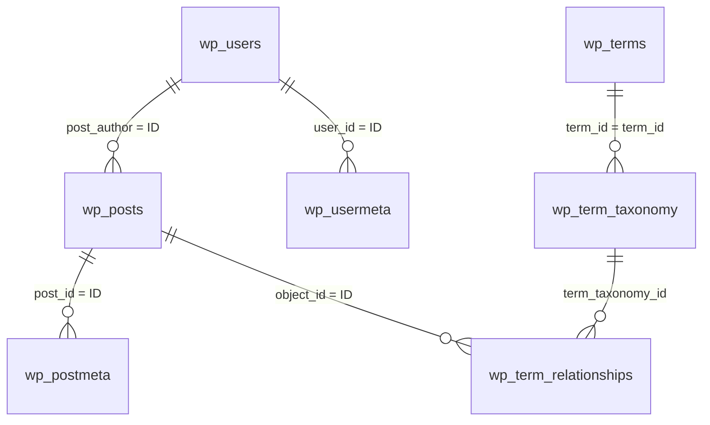

# ساختار پایگاه داده سامانه فرصت‌های دانشکده — نسخه ۱

## تصمیم معماری

نسخه ۲ علاوه بر جدول‌های استاندارد وردپرس، **فقط یک جدول** اضافه می‌کند: `{prefix}fcp_applications` (درخواست‌های دانشجویان). این جدول هنگام فعال‌سازی یا به‌روزرسانی با `dbDelta` ساخته می‌شود و نیازی به اجرای SQL دستی نیست. جدول‌ها به‌صورت خودکار در هنگام نصب وردپرس موجودند و داده‌های سامانه پس از فعال‌سازی افزونه در آن‌ها نوشته می‌شوند.

> در مثال‌های زیر پیشوند جداول `wp_` است. در وردپرس نصب‌شده ممکن است پیشوند دیگری تنظیم شده باشد؛ برای یافتن آن، مقدار `$table_prefix` را در `wp-config.php` ببینید.

## افزوده‌ی نسخه ۲.۱: توصیه‌ها

نوع محتوای `fcp_advice` (در `wp_posts`) برای توصیه‌ها و یک جدول سبک برای رأی‌ها. نسخه‌ی ساختار: `fcp_db_version = 3`.

**`wp_posts` با `post_type = 'fcp_advice'`**: `post_title` عنوان، `post_content` متن (متن ساده با `## ` و `- `)، `post_excerpt` خلاصه‌ی اختیاری، `post_author` استاد نویسنده، `post_status` برابر `pending` پس از ارسال و `publish` پس از تأیید مدیر.

| `meta_key` (در `wp_postmeta`) | کاربرد |
|---|---|
| `_fcp_audience` | `newcomer` یا `senior` |
| `_fcp_topic` | موضوع؛ فقط ترکیب‌های معتبر پذیرفته می‌شود (پایین) |
| `_fcp_helpful` | شمارنده‌ی ذخیره‌شده‌ی رأی‌ها برای مرتب‌سازی؛ منبع حقیقت جدول رأی‌هاست |
| `_fcp_views` | بازدید (مثل آگهی‌ها) |

موضوع‌های معتبر: برای `newcomer` ← `start`, `study`, `skills`, `general`؛ برای `senior` ← `field`, `thesis`, `masters`, `career`, `general`. اعتبارسنجی هم در فرم استاد و هم در پیشخوان مدیر روی سرور انجام می‌شود.

**جدول `wp_fcp_advice_votes`**

| ستون | نوع | توضیح |
|---|---|---|
| `id` | bigint PK | |
| `advice_id` | bigint | `wp_posts.ID` توصیه |
| `voter_hash` | char(64) | SHA-256 نمکی از IP و مرورگر؛ قابل بازگشت به IP نیست |
| `created_at` | datetime | |

کلیدها: `UNIQUE (advice_id, voter_hash)` (هر بازدیدکننده فقط یک رأی)، `KEY (created_at)`. با حذف دائمی توصیه، رأی‌هایش هم حذف می‌شوند. رأی‌دادن دوباره، رأی را برمی‌دارد (toggle).

## نمودار روابط

## جدول‌ها و روابط

| جدول استاندارد وردپرس | کلید مهم | کاربرد در سامانه |
|---|---|---|
| `wp_users` | `ID` | حساب اختصاصی اساتید؛ `user_login` نام کاربری و `user_pass` هش رمز عبور، نه رمز خام |
| `wp_usermeta` | `user_id` | نقش استاد با کلید متغیرِ `{prefix}capabilities` و اطلاعات پروفایل |
| `wp_posts` | `ID` و `post_author` | آگهی‌ها با `post_type = 'fcp_opportunity'` و ارتباط با استاد از طریق `post_author` |
| `wp_postmeta` | `post_id`, `meta_key` | محل فعالیت، حالت همکاری، مهلت، شرایط و راه تماس آگهی |
| `wp_terms` | `term_id` | نام و شناسه دسته‌بندی‌ها |
| `wp_term_taxonomy` | `term_taxonomy_id` | نوع دسته‌بندی با `taxonomy = 'fcp_category'` |
| `wp_term_relationships` | `object_id`, `term_taxonomy_id` | انتساب یک یا چند دسته به آگهی |
| `wp_options` | `option_name` | شناسه صفحات ساخته‌شده در گزینه `fcp_pages` و تنظیمات اصلی وردپرس |

**نکته:** «استاد» یک نقش وردپرسی با کلید `fcp_professor` است، نه یک جدول جداگانه. فقط مدیر سایت حساب جدید می‌سازد. رمزها به‌صورت امن توسط خود وردپرس مدیریت می‌شوند.

## جدول `wp_fcp_applications`

| ستون | نوع | توضیح |
|---|---|---|
| `id` | bigint PK | شناسه درخواست |
| `opportunity_id` | bigint | شناسه آگهی (`wp_posts.ID`) |
| `professor_id` | bigint | استاد صاحب آگهی (`wp_users.ID`) |
| `student_name`, `student_email` | varchar | مشخصات دانشجو (ایمیل همراه آگهی یکتاست) |
| `student_number`, `student_field` | varchar | شماره دانشجویی، رشته و مقطع |
| `message` | text | پیام دانشجو |
| `resume_file`, `resume_name` | varchar | نام تصادفی فایل در `uploads/fcp-private` و نام اصلی |
| `status` | varchar | `new`, `reviewing`, `accepted`, `rejected` |
| `professor_note` | text | یادداشت یا پیام استاد |
| `ip_hash` | char(64) | هش IP (برای ضدسوءاستفاده، نه خود IP) |
| `created_at`, `updated_at` | datetime | زمان ثبت و آخرین تغییر |

کلیدها: `UNIQUE (opportunity_id, student_email)`، `KEY (professor_id, status)`، `KEY (created_at)`.

## مشخصات آگهی (`wp_posts`)

| ستون | مقدار / معنا |
|---|---|
| `post_type` | `fcp_opportunity` |
| `post_title` | عنوان آگهی |
| `post_content` | شرح کامل فرصت |
| `post_author` | شناسه استاد در `wp_users.ID` |
| `post_status` | `pending` در زمان ارسال استاد، `publish` بعد از تأیید مدیر |
| `post_date` | تاریخ ایجاد/انتشار ذخیره‌شده در وردپرس |
| `ID` | شناسه یکتای آگهی |

## کلیدهای اضافی آگهی (`wp_postmeta`)

| `meta_key` | نوع منطقی | کاربرد |
|---|---|---|
| `_fcp_location` | متن | محل فعالیت یا همکاری |
| `_fcp_work_mode` | enum متنی | `onsite`, `remote`, `hybrid`, `flexible` |
| `_fcp_deadline` | متن تاریخ `YYYY-MM-DD` | مهلت ثبت درخواست؛ در این نسخه به‌صورت میلادی ذخیره می‌شود |
| `_fcp_requirements` | متن چندخطی | شرایط و مهارت‌های موردنیاز |
| `_fcp_contact_email` | ایمیل | ایمیل تماس که در آگهی عمومی نمایش داده می‌شود |
| `_fcp_apply_url` | URL | لینک درخواست خارجی (اختیاری) |
| `_fcp_views` | عدد | شمارنده بازدید آگهی |

## کلیدهای پروفایل استاد (`wp_usermeta`)

| `meta_key` | نوع منطقی | کاربرد |
|---|---|---|
| `_fcp_department` | متن | گروه آموزشی |
| `_fcp_interests` | متن | زمینه‌های تخصصی |
| `_fcp_bio` | متن چندخطی | شرح کوتاه پروفایل |
| `_fcp_must_change_password` | 0/1 | تا تغییر رمز موقت، پنل فقط بخش امنیت را نشان می‌دهد |

نام نمایشی استاد در فیلد استاندارد `wp_users.display_name` ذخیره می‌شود. ایمیل حساب استاد از `wp_users.user_email` بدون اجازه جداگانه به بازدیدکنندگان نمایش داده نمی‌شود.

## دسته‌ها (`wp_terms` و `wp_term_taxonomy`)

دسته‌های پیش‌فرض که در زمان فعال‌سازی افزونه ساخته می‌شوند:

- پژوهشی (`research`)
- شغلی (`employment`)
- کارآموزی (`internship`)
- پروژه و پایان‌نامه (`thesis`)

مدیر از بخش «فرصت‌های دانشکده ← دسته‌بندی فرصت‌ها» می‌تواند دسته‌های جدید اضافه کند یا آن‌ها را ویرایش کند.

## منطق نمایش و مجوزها

1. صفحه خانه فقط ده رکورد جدید با وضعیت `publish` از نوع `fcp_opportunity` نشان می‌دهد.
2. صفحه عمومی استاد فقط آگهی‌های منتشرشده همان `post_author` را نمایش می‌دهد.
3. استادِ واردشده فقط آگهی‌های خودش را در پنل خصوصی می‌بیند؛ سرور شناسه نویسنده را با کاربر واردشده تطبیق می‌دهد.
4. ثبت جدید و ویرایش آگهی، وضعیت آن را `pending` می‌کند تا مدیر تأیید کند.
5. تأیید نهایی را مدیر از پیشخوان وردپرس ویرایش وضعیت آگهی انجام می‌دهد.

## گزینه‌ها (`wp_options`)

`fcp_pages` (شناسه برگه‌ها)، `fcp_settings` (نام برند و تماس)، `fcp_db_version` (نسخه ساختار جدول).

## توسعه‌های آینده

چنانچه در نسخه‌های بعدی درخواست مستقیم دانشجویان، بارگذاری رزومه، اعلان ایمیلی یا گردش‌کار چندمرحله‌ای اضافه شود، می‌توان برای «درخواست‌های دانشجویان» یک نوع محتوای جدید یا جدول اختصاصی طراحی کرد. در نسخه ۲ ثبت درخواست دانشجو پیاده‌سازی شده است؛ ورود یکپارچه دانشگاهی و حساب دانشجویی هنوز نیست.
